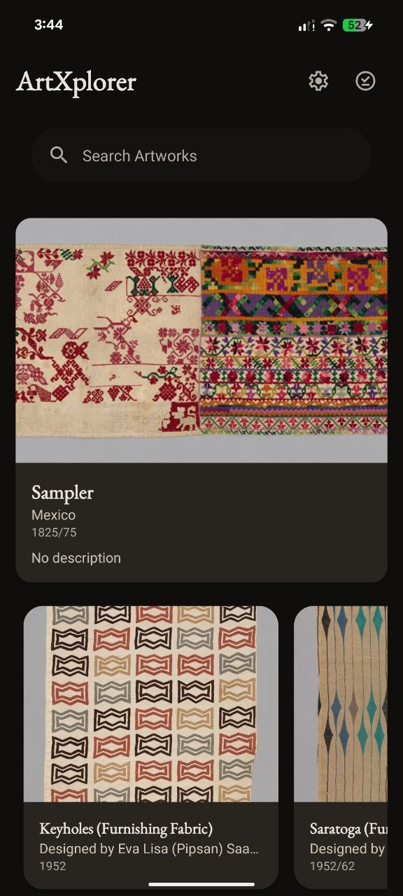
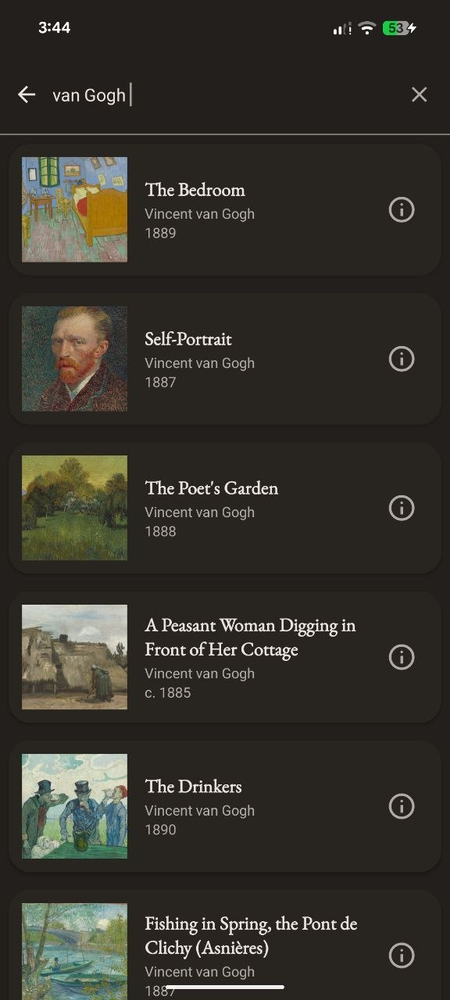
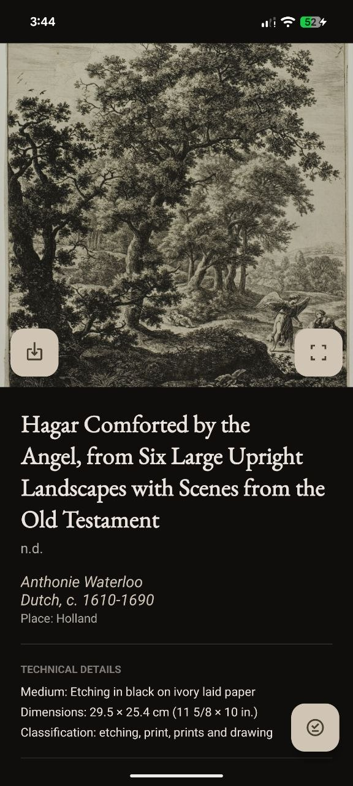
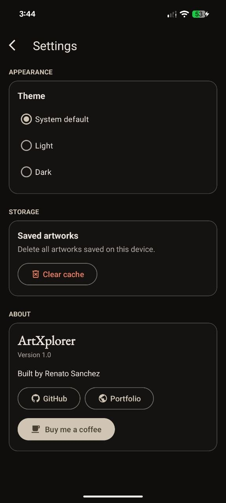
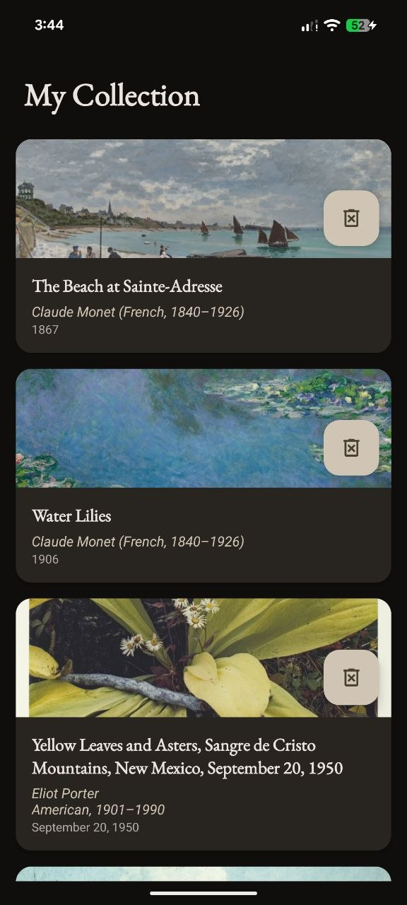

# ArtXplorer

An Android app for browsing, searching and collecting artworks from the Art Institute of Chicago's public collection.

ArtXplorer is a small, focused client for the [Art Institute of Chicago API](https://api.artic.edu/docs/): a home feed of highlights, full-text search, rich artwork details, and a personal collection that lives on the device. It is built with Kotlin, follows a clean MVVM layering, and works in light and dark themes.

## Features

- **Home feed** — a featured "random artwork" card plus a paginated grid of collection highlights, with pull to refresh.
- **Search** — search by title, artist or keyword; results show a thumbnail, artist and year, and an info dialog with the raw metadata.
- **Artwork details** — large image, artist, origin, medium, dimensions, style, classification, credit line and copyright notice.
- **More by the artist** — up to three related works by the same artist, excluding the artwork you are viewing.
- **Fullscreen viewer** — pinch to zoom, pan, and double-tap to zoom in or reset.
- **My Collection** — save artworks locally, browse them later, remove individual items or clear the whole collection.
- **Download** — save an artwork as a JPEG to the device's Pictures folder.
- **Settings** — system/light/dark theme, saved-artwork count, clearing all saved artworks, version info and links.

## Screenshots

| Home                                        | Search                                           | Artwork details                                            | Settings                                       | My Collection                                          |
|---------------------------------------------|--------------------------------------------------|------------------------------------------------------------|---------------------------------------------------------|--------------------------------------------------------|
|  |  |  |  |  |

## Requirements

- Android Studio (latest stable) with the Android SDK 36 platform
- JDK 17 or newer (bundled with Android Studio)
- Android 7.0 (API 24) or newer on the device or emulator
- An internet connection; no API key is needed

## Getting started

```bash
git clone https://github.com/renatosanz/ArtXplorer.git
cd ArtXplorer
```

Open the project in Android Studio and press **Run**, or build and install from the command line:

```bash
./gradlew installDebug
```

This builds the debug APK and installs it on the connected device or emulator. Run `./gradlew assembleDebug` instead if you only want the APK; AGP 9 writes it under `app/build/intermediates/apk/debug/`.

On Windows use `gradlew.bat` instead of `./gradlew`.

## Tests

```bash
./gradlew test              # unit tests
./gradlew connectedAndroidTest   # instrumented tests, needs a device or emulator
```

## Tech stack

| Area | Choice |
| --- | --- |
| Language | Kotlin |
| UI | Activities + XML layouts, ViewBinding, Material Components |
| Architecture | MVVM with use cases and a repository layer |
| Dependency injection | Koin |
| Networking | Retrofit + Gson |
| Local storage | Room (KSP) |
| Image loading | Coil 3 |
| Zoomable images | Custom `ZoomableImageView` (Android `Matrix`) |
| Build | Gradle 9, AGP 9.2 |

`minSdk` is 24, `targetSdk` is 36.

## Project structure

```
app/src/main/java/com/renatosanz/artxplorer/
├── data/          # API service and DTOs, Room database, repository, file helpers
├── domain/        # models, repository interface, use cases
├── di/            # Koin modules
└── presentation/  # activities, view models, adapters, layouts
```

## Data and attribution

Artwork data and images come from the [Art Institute of Chicago](https://www.artic.edu/) through its public API and IIIF image service. The app is an unofficial client and is not affiliated with or endorsed by the museum. Artwork records and images remain subject to the museum's own terms of use.

## Contributing

Issues and pull requests are welcome. Keep changes focused and explain the "why" in the PR description; the project follows Conventional Commits for its history.

## License

Released under the [MIT License](LICENSE). © 2026 Renato Sanchez.

## Links

- GitHub: [github.com/renatosanz/ArtXplorer](https://github.com/renatosanz/ArtXplorer)
- Portfolio: [portfolio.riprtx.uk](https://portfolio.riprtx.uk/)
- Support: [buymeacoffee.com/renatosanz](https://www.buymeacoffee.com/renatosanz)
